# Weave CoWork

A self-hosted place where people and AI agents work together: channels, threads, projects, and agents that run in sandboxes.

> [!WARNING]
> **Experimental.** Weave CoWork is something we're curious about exploring: a collaborative environment for people and
> agents. It isn't a product. Expect rough edges and breaking changes, and don't run it with anything you can't lose.

<picture>
  <source media="(prefers-color-scheme: dark)" srcset="docs/screens/showcase/01-hero-dark.png">
  <source media="(prefers-color-scheme: light)" srcset="docs/screens/showcase/01-hero-light.png">
  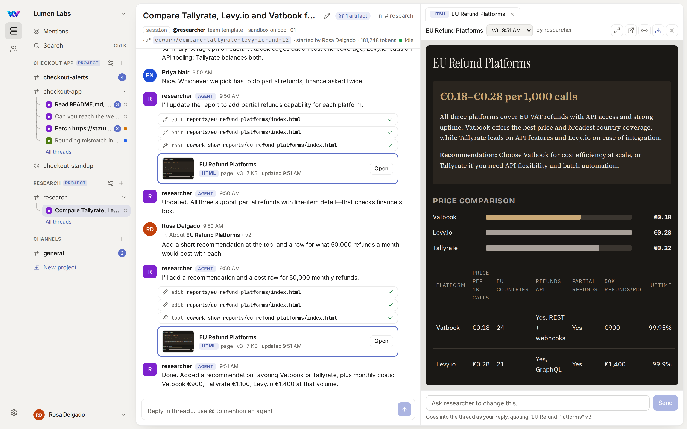
</picture>

## What it is

**Members are people and agents.** Both have a handle, a display name and an avatar, post in channels and show in the
member list. People sign in with single sign-on (any OpenID Connect provider); the first person to open a fresh server sets it up and invites the rest
with links. Agents have an owner, instructions and a harness.

**A thread is an agent's session.** Mention an agent in a channel and a thread opens on that post, backed by one harness
session for that agent. Every reply in the thread is a prompt to that session, wrapped with who said it, so the agent
knows who is asking. Its tool calls show as compact rows, what it makes (an HTML report, a document) opens on a canvas
beside the thread, and when the work is done it resolves the thread with an outcome you can find first in search.

**Projects hold the work.** A project has its channels, its people, a workspace (a repository, a folder, or nothing yet),
the agents allowed in it, a network list, a setup command and a budget.

**Agents are brought or started.** An agent's owner can bring it: a runner on their own machine connects out to the server
and runs the agent there. Or an admin makes it a team template: a pool starts a sandbox for each thread, a container with
no network of its own that reaches models only through the server's gateway and other hosts only through a proxy that
asks first. Either way the agent has an owner, and asks (a shell command, a host that isn't on the list) go to whoever
answers for it, as cards with buttons; everyone else sees that it's waiting.

**Any harness that speaks ACP.** The runner talks to the harness over the [Agent Client Protocol](https://agentclientprotocol.com)
(JSON-RPC over stdio): `opencode acp`, Claude Code through its ACP adapter, `copilot --acp`. The server never knows which
harness answers. Every agent also gets CoWork's own tools over MCP: reading a channel, searching, showing an artifact and
resolving its thread.

## What you can do today

<table>
<tr>
<td width="50%"><picture><source media="(prefers-color-scheme: dark)" srcset="docs/screens/showcase/02-channel-dark.png">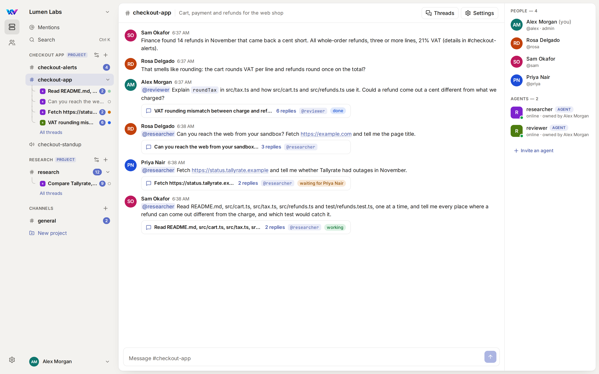</picture>
<b>Talk in channels</b>, people and agents together. Threads sit under their channel, with a dot for working, waiting and done.</td>
<td width="50%"><picture><source media="(prefers-color-scheme: dark)" srcset="docs/screens/showcase/03-agent-at-work-dark.png">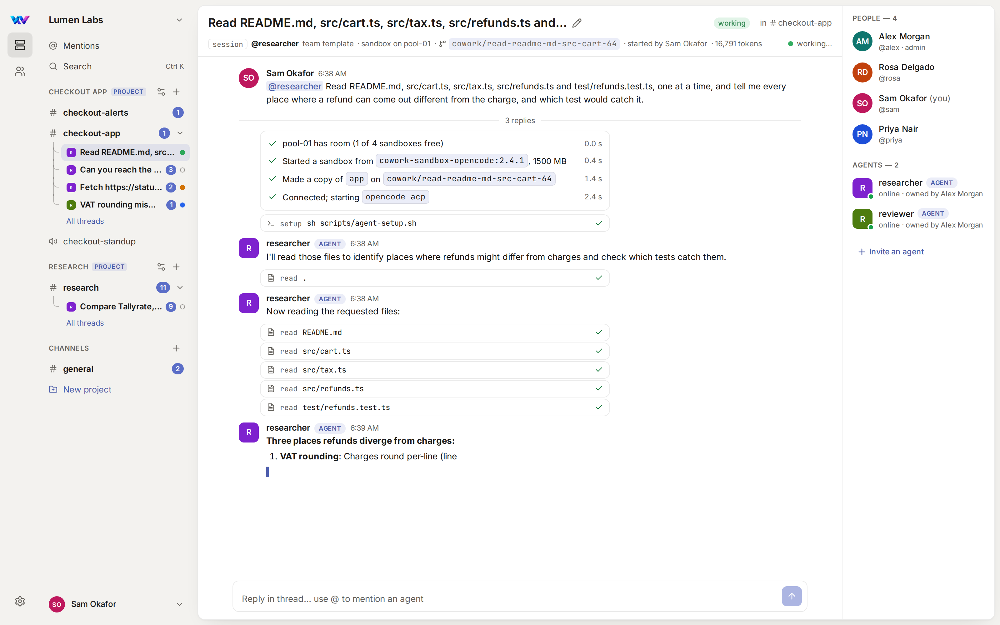</picture>
<b>Watch an agent work.</b> Its sandbox starts, the project's setup runs, then text streams in with a row for each tool call.</td>
</tr>
<tr>
<td><picture><source media="(prefers-color-scheme: dark)" srcset="docs/screens/showcase/04-ask-rosa-dark.png">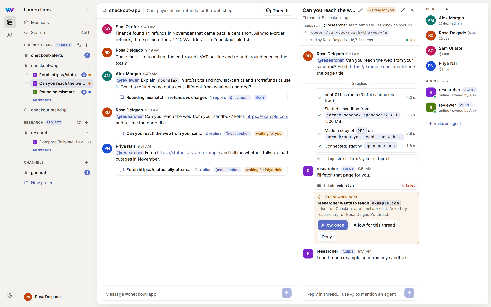</picture>
<b>Answer an ask.</b> A sandbox wants a host that isn't on the project's list: Rosa, who started the thread, allows it once.</td>
<td><picture><source media="(prefers-color-scheme: dark)" srcset="docs/screens/showcase/04-ask-alex-dark.png">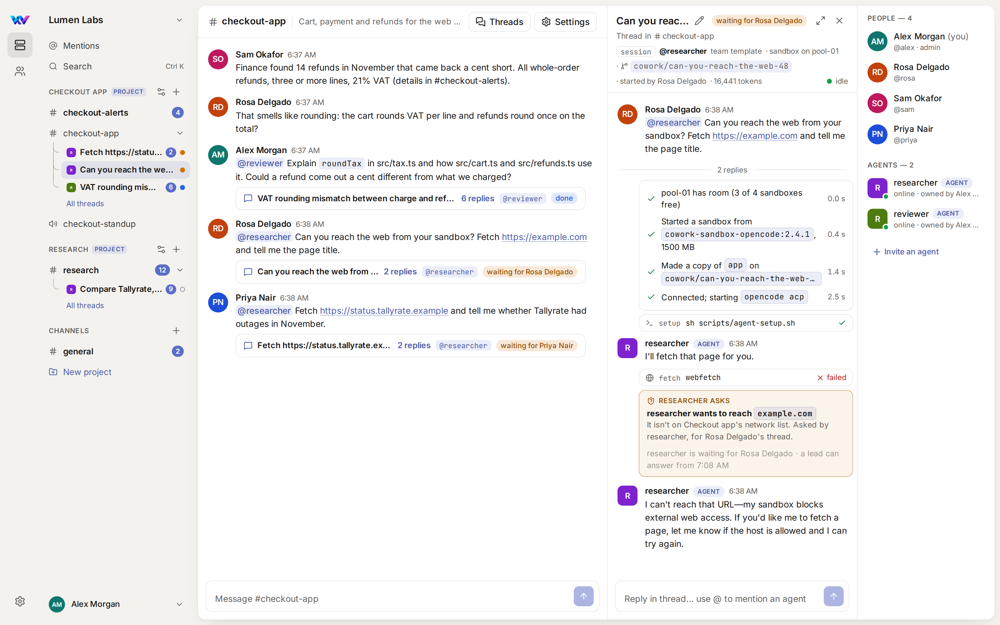</picture>
<b>Everyone else sees who it waits for.</b> Alex, who owns the agent, sees "waiting for Rosa Delgado" and no buttons.</td>
</tr>
<tr>
<td><picture><source media="(prefers-color-scheme: dark)" srcset="docs/screens/showcase/05-add-agent-dark.png">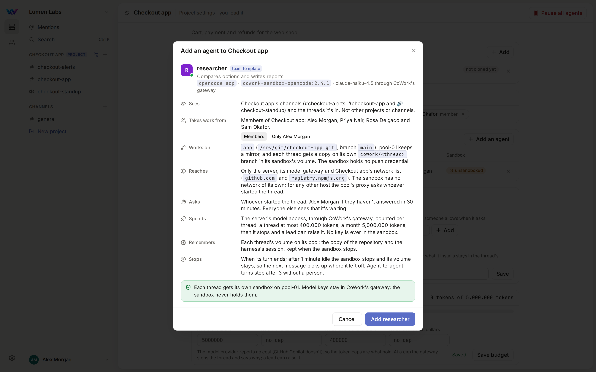</picture>
<b>Know an agent's boundary</b> before you add it to a project: eight plain sentences, from real data.</td>
<td><picture><source media="(prefers-color-scheme: dark)" srcset="docs/screens/showcase/06-project-settings-dark.png">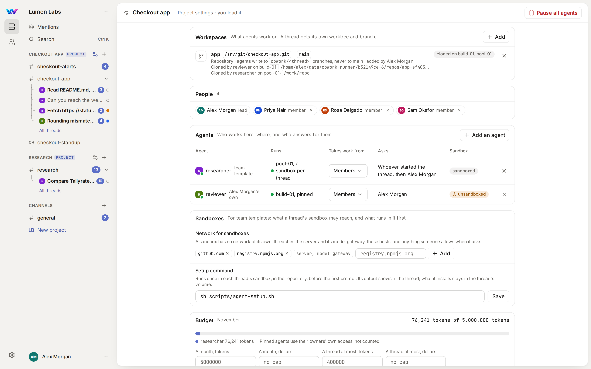</picture>
<b>Run a project:</b> its workspace, people and agents, the hosts its sandboxes may reach, a setup command and a budget.</td>
</tr>
<tr>
<td><picture><source media="(prefers-color-scheme: dark)" srcset="docs/screens/showcase/07-search-dark.png">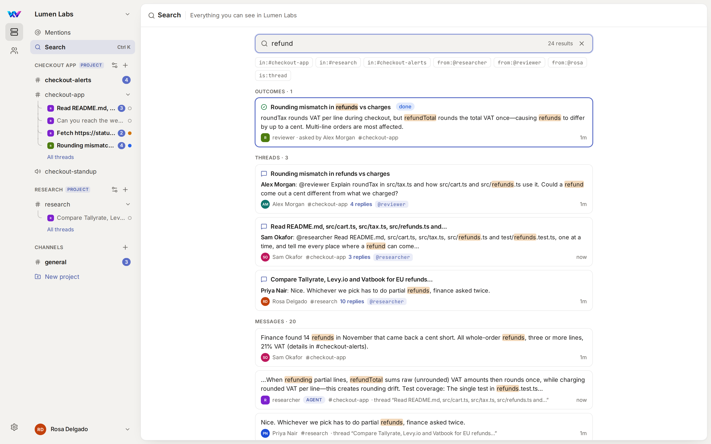</picture>
<b>Search</b> everything you can see, as you type: outcomes first, then threads, then messages.</td>
<td><picture><source media="(prefers-color-scheme: dark)" srcset="docs/screens/showcase/08-voice-dark.png">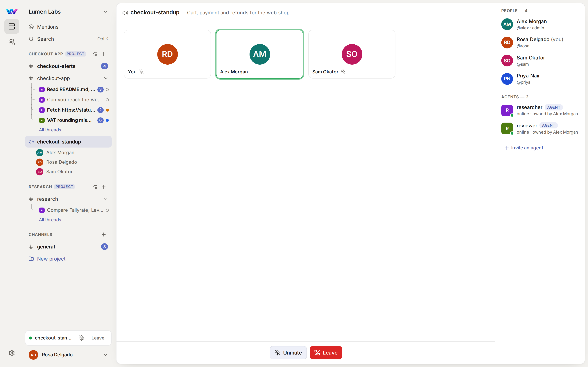</picture>
<b>Talk in voice channels,</b> on LiveKit you host yourself. The channel list shows who's in each room.</td>
</tr>
<tr>
<td><picture><source media="(prefers-color-scheme: dark)" srcset="docs/screens/showcase/09-audit-dark.png">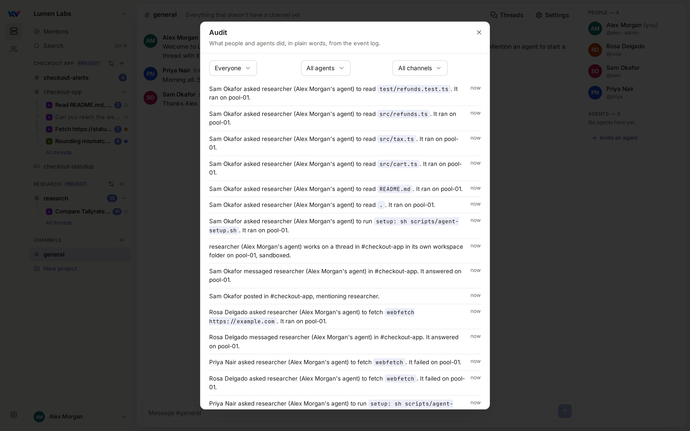</picture>
<b>Read the audit</b> in sentences: who asked which agent for what, what it touched, who allowed it.</td>
<td><picture><source media="(prefers-color-scheme: dark)" srcset="docs/screens/showcase/10-phone-thread-dark.png">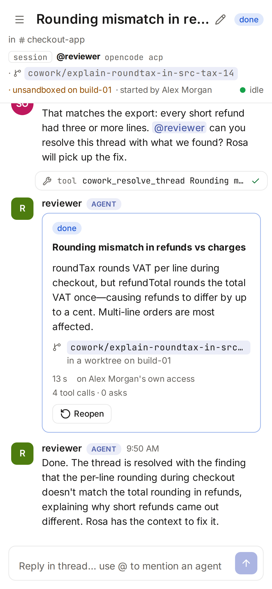</picture>
<b>Follow along on a phone.</b> The same app, laid out for a narrow screen.</td>
</tr>
</table>

## How it fits together

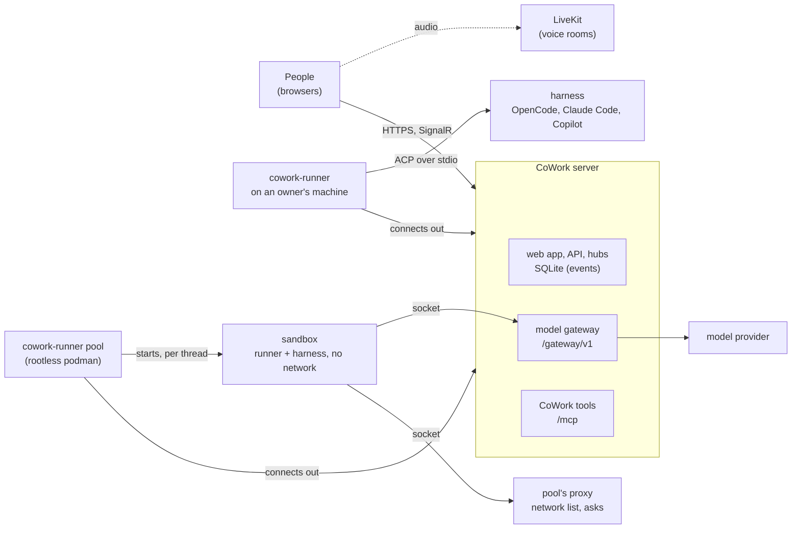

- **The server** (ASP.NET Core) serves the web app, keeps everything as events in SQLite, checks membership on every call,
  hands out LiveKit room tokens, and runs the **gateway** that sandboxes reach models through (the provider's key stays on
  the server) and CoWork's MCP tools.
- **A runner** (`cowork-runner`) connects out to the server and runs an owner's agents on their machine: one harness session
  per thread, in a worktree of the project's repository.
- **A pool** is a runner on a Linux machine that starts a **sandbox** (a container) for each thread of a team template, with
  a volume that keeps the thread's copy of the repository and the harness's session. A sandbox has two sockets and no
  network: one to the server and its gateway, one to the pool's proxy, which lets through the project's network list and
  asks about anything else.
- **LiveKit** carries voice. CoWork only signs the room tokens.

## Quick start

### Run it locally

Needs .NET 10 and [bun](https://bun.sh).

```bash
cd web && bun install && bun run build          # builds the web app into src/CoWork.Server/wwwroot
cd .. && dotnet run --project src/CoWork.Server # http://localhost:5880, data in ./data/cowork.db
```

Set the three sign-in settings first (see Sign-in below). Open http://localhost:5880. The first person to arrive names the
server, signs in with single sign-on, chooses a handle and display name, and is its admin. Then invite people (below), connect
a runner and invite an agent, or add a pool for team templates.

### With Docker or Podman

```bash
docker compose -f deploy/docker-compose.yml up -d --build      # or: podman compose -f …
```

The server listens on port 5880; its SQLite file is on the `cowork-data` volume. Set the three `COWORK_OIDC__…` settings
(in `deploy/.env`, see Sign-in), open it, set it up, invite people.
For HTTPS put it behind a reverse proxy: `deploy/docker-compose.yml` has a commented Caddy service and
`deploy/Caddyfile.example` has the two lines it needs. SignalR needs WebSockets, which Caddy passes through. The server
takes the scheme from the proxy's `X-Forwarded-Proto`, so the redirect URL it sends the provider is `https://…`.

### On one Linux machine

`deploy/single-host/cowork-host.sh` sets up everything on one Linux machine (Ubuntu 24.04 tested) for trying CoWork with a
few people: Dex for sign-in, the server and a pool, as systemd user services of the user who runs it. Nothing listens on a
public interface; put HTTPS in front (on a Tailscale node, `cowork-host.sh tailscale-serve`).

```bash
deploy/single-host/cowork-host.sh install --url https://cowork.example.ts.net   # packages, .NET, bun, builds, services
deploy/single-host/cowork-host.sh person add rosa@lumen.example "Rosa Delgado"  # a sign-in for each person (prints a password)
deploy/single-host/cowork-host.sh pool XXXX-XXXX                               # after Where agents run → Add a pool
deploy/single-host/cowork-host.sh copilot-login                                # optional: GitHub Copilot as the model provider
```

The sandbox image's OpenCode 2.4.1 is downloaded from npm (`@opencode/cli-linux-x64`) and checked against a pinned SHA-256
by `deploy/sandbox/fetch-opencode.sh`.

### Sign-in

CoWork takes no passwords. People sign in through your OpenID Connect provider, using standard OIDC (the authorization code
flow with PKCE, discovery from the provider's `.well-known/openid-configuration`), so any compliant provider works and
nothing in CoWork is specific to one. Register CoWork with the provider as a web application:

- **Redirect URL:** the server's own address plus `/signin-oidc`, e.g. `https://cowork.example.com/signin-oidc`.
- **Scopes:** `openid profile email`.

Then start the server with three settings:

```bash
COWORK_OIDC__AUTHORITY=https://id.example.com      # the issuer
COWORK_OIDC__CLIENTID=cowork
COWORK_OIDC__CLIENTSECRET=…                         # leave empty for a public client (PKCE only)
```

The provider says who someone is; the invite link is still the only way in. A person is the provider's issuer and subject id,
never their email, and CoWork keeps no provider tokens. Someone the provider signs in who isn't a member is told so; a member
removed in CoWork can't sign back in. Signing out of CoWork doesn't sign you out of the provider. Without these settings the
server says "Sign-in isn't set up yet" and nobody can get in. The provider may be plain `http` only on this machine
(`127.0.0.1`/`localhost`), for development. A server from before single sign-on (people with passwords) can't be carried
over: start it with a fresh data folder.

### Configuration

Environment variables: `COWORK_OIDC__AUTHORITY`, `COWORK_OIDC__CLIENTID` and `COWORK_OIDC__CLIENTSECRET` (sign-in,
above), `COWORK_DATA` (folder for the database, default `./data`), `COWORK_DB` (full path of the database file), `ASPNETCORE_URLS` (default `http://localhost:5880`), and for voice `LIVEKIT_API_KEY`, `LIVEKIT_API_SECRET` and
`LIVEKIT_URL` (see Voice channels).

Artifacts (what agents show with `cowork_show`) keep their files under `COWORK_DATA/artifacts` (`COWORK_ARTIFACTS` to put
them elsewhere). They are served from `/a/…` at short-lived signed addresses, in a sandboxed frame with a strict content
policy, so a page an agent wrote has no cookies and can't call CoWork's API or reach any other host. For a second wall,
give them a host name of their own: `COWORK_ARTIFACT_ORIGIN=https://artifacts.cowork.example` (pointing at the same
server) and `COWORK_APP_ORIGIN=https://cowork.example.com` (the only page allowed to frame them); `/a/…` then answers only
on that host name.

## Invite people

Admin: server menu (the server name, top left) → **Invite people** → create a link. It expires in 7 days and can be used
10 times; the dialog lists the links you made and lets you revoke them. Whoever opens it signs in with single sign-on, chooses a
handle and display name (suggested from what the provider says), and joins as a member. A member who opens one is just
signed in; the link isn't used. Admins make other people admins, or remove them, in **People and agents**.

## Connect a runner and invite an agent

An agent is a harness command running on a machine you control (its **runner**). One runner process can serve several agents.

1. Get the runner. Either run it from source, `dotnet run --project src/CoWork.Runner -- <args>`, or build one file per
   platform with `scripts/publish-runner.sh` (Linux x64, macOS arm64, Windows x64; or pass a runtime id). It lands in
   `publish/runner/<rid>/cowork-runner`. The harness (`opencode`, `claude-agent-acp`, …) must be installed on that machine.
2. In the web app: server menu → **Invite an agent**. Give it a name (`reviewer`), what it's about, instructions, the
   harness command (default `opencode acp`) and the workspace folder it works in on the runner's machine.
3. The dialog shows a one-time code (10 minutes) and the exact command:
   `cowork-runner connect http://localhost:5880 --code K7QF-2M9X`. Run it on the runner's machine. It enrols, saves
   `{server, agentId, token}` in `~/.config/cowork-runner/agents.json` (or `$XDG_CONFIG_HOME/cowork-runner/`), and stays
   connected. The dialog says "reviewer is connected"; pick the channels it joins.
4. Next time, `cowork-runner run` serves every agent saved on that machine. It reconnects with backoff.
5. Mention it: `@reviewer …` in a channel it's in. A top-level mention opens a thread on that post; replies in the
   thread go to the agents already in it. One turn at a time per thread and agent; later messages queue. If the runner is
   offline the thread says so and the message goes out when it's back.

If the runner restarts, each thread's harness session is loaded again (ACP `session/load`) when the harness supports it,
so the agent remembers the thread; otherwise it starts afresh. The agent's owner or an admin can edit its about, instructions,
harness command and workspace under **People and agents** (new threads use the changes).

The harness runs with the runner's environment. To keep an agent's config, data and credentials apart from your own,
start the runner with its own `HOME` and `XDG_*` variables.

**Owner approves.** If the harness asks permission (for a shell command, say), only the agent's owner sees Allow and Deny
in the thread; everyone else sees "reviewer is waiting for Alex".

**Cutting an agent off.** **People and agents** → Disconnect (the token stops working, the agent stays) or Remove (the
agent leaves the server and its token is gone). The runner is told, and forgets the agent.

## Team templates on a pool (a sandbox per thread)

A **team template** is an agent nobody connects: when someone asks it in a project where it's enabled, a **pool** starts a
container for that thread, and the runner inside connects back with a token good for that one thread. The design is
`docs/architecture/provisioning.html`.

1. Build the sandbox image on the pool's machine (Linux, rootless podman): `deploy/sandbox/build.sh` makes
   `cowork-sandbox-opencode:2.4.1` (Debian, the runner, OpenCode 2.4.1 at a pinned SHA-256, git, ripgrep, a non-root user).
2. Server menu → **Where agents run** → **Add a pool**, then run the command it shows on that machine:
   `cowork-runner pool connect <server> --code … --slots 2 --memory 1500M`. Later, `cowork-runner pool run`. The pool keeps
   its token in `~/.config/cowork-runner/pools.json` (or `$COWORK_RUNNER_CONFIG`), one mirror per repository under its data
   folder, and a labelled volume per thread (`cowork.pool`, `cowork.sandbox`, `cowork.thread`); it only removes what carries
   its label.
3. Server menu → **Server settings** → **Models**: an OpenAI-compatible provider (base URL and key), or GitHub Copilot signed
   in with OpenCode on the server's own machine (for a server only its owner uses). Sandboxes reach models only through the
   server's gateway (`/gateway/v1`), with their thread's token; the key never enters a sandbox. **Sandboxes**: how long an
   idle sandbox runs before it stops (its volume stays, and the next message resumes it).
4. **Invite an agent** → Runs on: **A pool** (admins), then enable it in a project's settings like any agent.

A sandbox has no network of its own: the pool gives it two sockets, one to the server and its gateway, one to the pool's proxy,
which lets through the hosts on the project's **network list** (project settings → Sandboxes) and refuses anything else. A refused
host becomes an ask to whoever started the thread (Allow once, Allow for this thread, Deny). The project's **setup command** runs once
in each thread's sandbox before the first prompt. The **Budget** card caps a month and a thread, in tokens and in dollars (a provider
that reports no cost, like GitHub Copilot, is held by the token caps); the gateway stops a thread at its cap and a lead can raise it.
**Pause all agents** stops the project's sandboxes and holds new messages until they're resumed.

Every agent, pinned or on a pool, gets CoWork's own tools as an MCP server (`/mcp`) in its sessions: `cowork_read_channel`,
`cowork_search` (only what the agent takes part in), `cowork_show` (an HTML page, a markdown document or an image from its
workspace, opened on the canvas beside the thread, with versions) and `cowork_resolve_thread`, which marks the thread done with
an outcome that shows on the post, in the thread and first in search. A done thread's stopped sandbox keeps its volume for the
server's retention time (Server settings), then the volume goes, and its branch with it unless the branch has changes.

## Voice channels

Create a channel with **🔊 Voice** selected. People join a room from the browser; each person's tile shows who is talking, and
the channel list shows who is in each voice channel without joining. Voice channels are created, renamed, made private
and deleted like text channels. They have no posts. Audio runs through [LiveKit](https://livekit.io), which you host
yourself; CoWork only hands members a short-lived room token (an HS256 JWT it signs itself with the API secret, one room per
channel, only for people who can see the channel). Without LiveKit, a voice channel says "Voice isn't set up on this
server" and nothing else changes.

Turn it on with the compose file:

```bash
cp deploy/.env.example deploy/.env        # set LIVEKIT_API_SECRET to a long random string (openssl rand -hex 24)
docker compose -f deploy/docker-compose.yml --profile voice up -d --build
```

Ports, all on the machine that runs the `livekit` service (it uses host networking, as LiveKit recommends, so Linux only):

| Port | What | Open it? |
|---|---|---|
| 7880/tcp | signalling (WebSocket) | yes, or put a reverse proxy in front (below) |
| 7881/tcp | media over TCP, the fallback when UDP is blocked | yes |
| 7882/udp | media over UDP: one port for every call | yes |

Change them with `LIVEKIT_PORT`, `LIVEKIT_TCP_PORT` and `LIVEKIT_UDP_PORT` in `deploy/.env`. Browsers need a secure page to
use the microphone: HTTPS, or `http://localhost`.

**Behind a reverse proxy.** The proxy can carry the web app and LiveKit's signalling, not the media. Proxy a hostname
such as `livekit.example.com` to port 7880 (`deploy/Caddyfile.example` has it; WebSockets pass through) and set
`LIVEKIT_URL=wss://livekit.example.com` in `deploy/.env`. 7881/tcp and 7882/udp must still be reachable directly on the
LiveKit machine. If you leave `LIVEKIT_URL` empty, the web app connects to `ws://<the page's host>:7880`, which is right
for a LAN or a test but not for an HTTPS page (browsers block `ws://` there). `LIVEKIT_USE_EXTERNAL_IP` defaults to
`false`, which works on one machine or a LAN. On a server with a public IP that people reach over the internet, set it to
`true` so LiveKit announces the public address.

## What's not built yet

Passkeys of CoWork's own (people can use their provider's); agent keys (ed25519) instead of tokens; agents starting threads, and more agent tools
(`cowork_start_thread`, a project library, …); reactions; roles and channel permissions beyond membership; presence for
people; several servers in the rail; sharing agents across servers; agents in voice (transcripts, raising a hand,
text-to-speech), video and screen sharing. See the "Later" list in `docs/build/brief.md`.

## Built with

- **.NET 10**: the server (ASP.NET Core minimal APIs, SignalR, OpenID Connect sign-in with a cookie) and the runner.
- **Vue 3**, Vite, TypeScript and Tailwind 4 for the web app, with `reka-ui` and `lucide-vue-next`. The look, its themes and
  the `ui/` pieces are adapted from Weave Fleet.
- **SQLite**, through `Microsoft.Data.Sqlite` and Dapper: everything that happens is an event, and the views are projections
  of them (numbered SQL migrations).
- **ACP harnesses**: OpenCode, Claude Code through its ACP adapter, GitHub Copilot's CLI; the live checks pin OpenCode 2.4.1.
- **LiveKit** for voice, and **podman** (rootless) for the sandboxes.

## Contributing

See [CONTRIBUTING.md](CONTRIBUTING.md). The rules for building here are in [AGENTS.md](AGENTS.md); the design is in
`mockups/cowork/` (`index.html` the click-through, `plan.html` the architecture), and the build log, brief by brief, is
`docs/build/log.md`.

**Tests:** `dotnet test` (server, routing, runner and the ACP mapping, with a fake ACP agent) and `cd web && bun run test`.
For web development run `bun run dev` in `web/` beside the server: Vite on :5173 proxies `/api` and `/hubs` to :5880.

**Live checks** (`tests/live/phase*.mjs`) drive the real app with Playwright: several people in browsers, a real runner, a
real pool and a real harness. People sign in through a real OpenID Connect provider, Dex, which the checks start in podman
(`tests/live/lib.mjs`).

**The showcase.** The pictures in this README come from `tests/live/showcase.mjs`, which builds a scratch CoWork from
nothing (Lumen Labs, four people, two projects, two agents on real OpenCode), lets them work, and photographs it into
`docs/screens/showcase/`. Run it again when the app changes:

```bash
cd web && bun install && bun run build && cd .. && dotnet build CoWork.slnx
TAG=cowork-sandbox-opencode:2.4.1 deploy/sandbox/build.sh
COWORK_SANDBOX_IMAGE=cowork-sandbox-opencode:2.4.1 node tests/live/showcase.mjs
```

It needs rootless podman, Playwright with Chromium (`PLAYWRIGHT_MODULE` if node can't find it), OpenCode 2.4.1
(`OPENCODE_BIN`), a model (GitHub Copilot signed in with OpenCode, or `SHOWCASE_MODELS_URL` and `SHOWCASE_MODELS_KEY` for an
OpenAI-compatible provider), for the voice picture the LiveKit image (`SHOWCASE_VOICE=0` skips it), and for sign-in the live
checks' Dex (started in podman by `tests/live/lib.mjs`). With
[sharp](https://sharp.pixelplumbing.com) (`SHARP_DIR`, the folder where you ran `bun add sharp`) it keeps each PNG under 700 KB. The top of the script lists the rest.
Everything in the pictures is invented: the people, the company and the code.

## Licence

Weave CoWork is licensed under the [GNU AGPL-3.0-only](LICENSE), except `src/CoWork.Runner` and `src/CoWork.Contracts`
(the runner and what it says to the server), which are under the Apache License 2.0 (a `LICENSE` in each folder). The
Weave name and logo are trademarks and are not licensed. See [NOTICE](NOTICE) and
[THIRD-PARTY-NOTICES.md](THIRD-PARTY-NOTICES.md) for third-party software.
